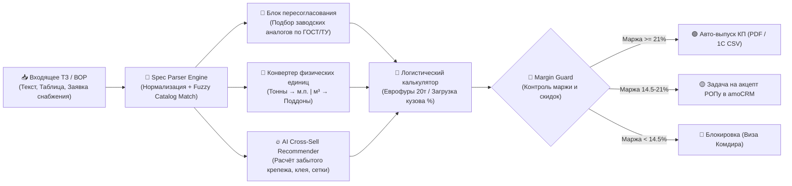

# 📐 B2B Spec Parser & Automated Proposal Engine

> **Инженерно-коммерческий AI-парсер строительных спецификаций, ведомостей объёмов работ (ВОР) и заявок снабжения с автоматическим пересчётом единиц, подбором заводских аналогов, допродажей комплектующих (Cross-Sell) и контролем маржинальности КП.**

[](tests/)
[](https://python.org)
[](https://www.amocrm.ru)
[](LICENSE)

**▶️ Интерактивный инженерно-коммерческий стенд:** https://kilevoy.github.io/b2b-spec-parser/

> [!NOTE]
> **Дисклеймер:** Все цены, показатели себестоимости, артикулы 1С, расчёты маржинальности и наименования объектов в репозитории и веб-стенде являются смоделированными (демо-данными) для защиты коммерческой тайны и демонстрации работы алгоритмов.

---

## 🎯 Бизнес-проблема и эффект внедрения (ROI)

* **Главное узкое горлышко промышленных продаж:**  
  После того как лид квалифицирован, клиент присылает техническое задание — выписку из раздела КМ/АР, ведомость объёмов работ (ВОР) или неструктурированное письмо снабженца (*«Посчитайте металл, кассеты и газоблок по списку»*).  
  Менеджер пересылает заявку в ПТО / сметный отдел, где расчёт встаёт в очередь на **2–5 рабочих дней**. За это время до 35% горячих клиентов успевают оплатить счёт конкуренту, который ответил в тот же день.
* **Вторая проблема — потеря маржи и неполная комплектация:**  
  При ручном наборе счёта в 1С менеджеры забывают предложить сопутствующие высокомаржинальные комплектующие (клей, базальтовую сетку, фасадные кронштейны, EPDM-крепёж) и дают необоснованные скидки.

| Показатель | До внедрения (`Ручной расчёт через ПТО`) | После внедрения (`B2B Spec Parser`) |
| :--- | :--- | :--- |
| **Скорость выставления КП по спецификации** | 2–4 рабочих дня | **1,5 минуты (в присутствии клиента на линии)** |
| **Средний чек сделки (за счёт AI Cross-Sell)** | Базовый (только то, что просил клиент) | **+12% ... +18% (авто-расчёт крепежа, клея, подсистемы)** |
| **Конверсия из расчёта ТЗ в оплату** | ~22% (клиенты уходят к быстрым) | **38% (+16 п.п. за счёт эффекта первого КП)** |
| **Контроль минимальной маржи** | Ручной (частые ошибки со скидками) | **Автоматический светофор (Менеджер / РОП / Комдир)** |

---

## 🏛 Поддерживаемые производственные направления (3 проекта)

Система настроена на реальную специфику промышленного холдинга и интегрирована с логикой инженерных калькуляторов автора:

1. **🏭 Проект «Ангары и быстровозводимые здания»:**
   * Полнокомплектные каркасы зданий из ЛСТК, стеновые и кровельные сэндвич-панели, высокопрочный крепёж.
   * **Инженерная логика:** оптимизация индивидуальных некратных габаритов здания (например, `19×43 м`) на серийные заводские модули (`18×42 м`, шаг рам 6 м — экономия 14% без ожидания индивидуального КМ); оптимизация профилей из стали `С245 (t=2.5 мм)` на высокопрочную конструкционную сталь `S350GD (t=2.0 мм)` со снижением погонного веса на 20%; пересчёт заявок из тоннажа (`тн`) в погонные метры (`м.п.`).
2. **🏢 Проект «Кровли и фасадные системы» (включая группу продуктов «Профили ГПС»):**
   * Гнутые профили стальные (**ГПС: ПП, ПГС, ПЗ**), фасадные кассеты закрытого и открытого типа (`КФ-1`, `КФ-2`), направляющие профили `ПШ-50`, кронштейны `КР-150`.
   * **Инженерная логика (связка с [Калькулятором ГПС](https://kilevoy.github.io/gps/)):** если у заказчика заложен нестандартный профиль ГПС (например, `ПГС 215×65×20` с развёрткой `340 мм`, который при продольном раскрое стандартного рулона `1250 мм` даёт только 3 ручья и **18,4% оплачиваемого клиентом отхода**), система предлагает эквивалентный по несущей способности профиль `ПГС 200×50×20` с развёрткой `312 мм` (**ровно 4 ручья из рулона 1250 мм, отход 0,16%**), снижая цену погонного метра на **16%**.
3. **🧱 Проект «Автоклавный газобетон»:**
   * Стеновые и перегородочные блоки `D400`/`D500`/`D600`, U-блоки, армированные перемычки `ПГБ`.
   * **Инженерная логика:** пересогласование плотного блока `D600` (требующего утепления) на энергоэффективный конструкционно-теплоизоляционный блок `D400 B2.5` (проходит по СП 50.13330 в один слой и снижает нагрузку на фундамент на 22%); округление кубатуры заказа до **целых транспортных поддонов** (`1.875 м³`); автоподбор тонкошовного клея и базальтовой сетки.

---

## 🏗 Архитектура пайплайна



---

## 🚀 Быстрый старт

### 1. Клонирование и установка
```bash
git clone https://github.com/kilevoy/b2b-spec-parser.git
cd b2b-spec-parser
pip install -r requirements.txt
```

### 2. Запуск модульных тестов (Pytest)
```bash
python -m pytest -v
```

### 3. Консольная демонстрация расчёта ТЗ
```bash
python -m spec_parser.cli --demo --discount 3.0
```

### 4. Запуск веб-сервера и REST API (FastAPI)
```bash
uvicorn spec_parser.api:app --reload --port 8000
```
После запуска откройте в браузере `http://localhost:8000`.

---

## 📁 Структура репозитория

```text
b2b-spec-parser/
├── spec_parser/               # Ядро инженерно-коммерческого расчёта
│   ├── __init__.py
│   ├── models.py              # Pydantic v2 модели (Спецификация, Логистика, Маржа)
│   ├── catalog.py             # Справочник номенклатуры 1С по 3 направлениям + аналоги
│   ├── parser_engine.py       # Алгоритм распознавания, пересчёта единиц и AI Cross-Sell
│   ├── exporter.py            # Выгрузка в формат 1С (CSV) и amoCRM REST API v4
│   ├── api.py                 # FastAPI сервер
│   └── cli.py                 # Консольная утилита предпросмотра КП
├── tests/                     # Автоматические тесты (Pytest)
│   └── test_spec_parser.py
├── web/                       # Интерактивный веб-стенд (GitHub Pages + печать КП А4)
│   └── index.html
├── .env.example               # Шаблон переменных окружения
├── requirements.txt           # Зависимости
├── pytest.ini                 # Конфигурация тестов
└── README.md                  # Документация проекта
```

---

## 👨‍💼 Автор

**Андрей Рыкунов** — коммерческий руководитель с 26-летним опытом в промышленном B2B и автоматизации продаж.
* Portfolio: [kilevoy.github.io](https://kilevoy.github.io)
* GitHub: [@kilevoy](https://github.com/kilevoy)
* Telegram: [@rykunov](https://t.me/rykunov)
* Email: rykunov@gmail.com

